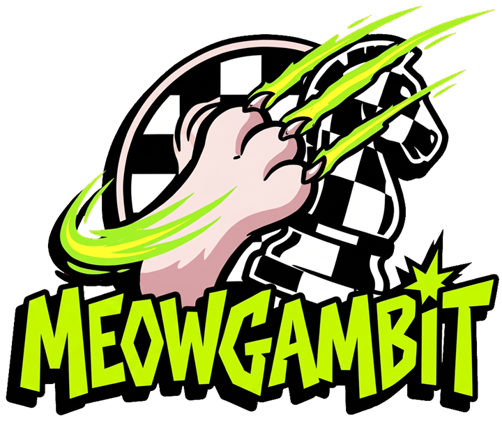

<p align="center">
  
</p>

<h1 align="center">MeowGambit — 2.5D Isometric Garden Arcade Chess PWA</h1>

<p align="center">
  <strong>Kerajaan Kucing (Cat Kingdom) vs Garda Anjing (Dog Guard)</strong><br />
  Game catur 2.5D Isometric bergaya <em>Casual Cartoon Garden</em> dengan animasi jurus <strong>"SLASH!"</strong>, 12 sprite chibi berdiri custom SVG, AI Minimax Alpha-Beta di Web Worker, suara arcade Web Audio API, dan dukungan penuh <strong>Bahasa Indonesia &amp; English</strong>.
</p>

---

## Fitur Utama

- **Aturan Catur Klasik 100% (`chess.js`)**: Validasi langkah legal, *check*, *checkmate*, *stalemate*, *insufficient material*, *threefold repetition*, *castling* (`O-O` / `O-O-O`), *en passant*, dan modal **Promosi Bidak** interaktif.
- **2.5D Isometric Garden Diorama & Lobby Courtyard**:
  - **Lobby (Main Menu)** berlatar halaman taman isometrik penuh warna dengan dinding batu, pagar kayu, bunga, meja catur batu, dan karakter chibi Kucing & Anjing berdiri di sekitar halaman, dipadukan dengan logo transparan **MeowGambit** dan kartu *Match Setup* bergaya *Casual Game UI*.
  - **Arena Gameplay** berupa papan catur 8×8 isometrik rumput hijau terang & sage berbingkai dinding batu taman, pagar kayu kecil, semak rimbun, dan bunga mini.
- **12 Sprite Chibi 2D Berdiri Custom SVG**:
  - **Kerajaan Kucing (Putih):** *Kitten Squire* (Pion), *Cat Knight* (Kuda), *Shield Cat* (Benteng), *Witch Cat* (Gajah), *Angora Empress* (Menteri), *Crowned Lion* (Raja).
  - **Garda Anjing (Hitam):** *Pup Cadet* (Pion), *Boxer Rogue* (Kuda), *Bulldog Tank* (Benteng), *Hound Mystic* (Gajah), *Doberman General* (Menteri), *Mastiff Monarch* (Raja).
- **Cinematic 1.2s Skill VFX & Animasi Serangan**:
  - Sorotan ubin menyala **kuning neon** (jalur langkah) & **biru neon** (target serangan) lengkap dengan panah arah di permukaan rumput isometrik dan balon **`TAP UNTUK SERANG!`**.
  - Saat *capture* atau *skak*: animasi lompatan menyerang, tebasan energi biru-emas melengkung, kepulan debu kartun, percikan energi, serta tipografi komik miring **`"SLASH!"` / `"SKAK!!"` / `"SKAKMAT!!"`** di atas HTML5 Canvas 60fps.
- **Mode Permainan & AI Web Worker**:
  - **Lawan Bot (Single Player):** Minimax + Alpha-Beta Pruning + Piece-Square Tables + MVV-LVA move ordering di Web Worker terpisah (`Mudah` Depth 1, `Sedang` Depth 2, `Sulit` Depth 3).
  - **2P Lokal (Pass & Play):** Dilengkapi toggle **Putar Papan Otomatis** antar giliran.
  - **Kontrol Waktu:** Kilat (3 menit), Cepat (10 menit), dan Santai (tanpa jam) dengan deteksi kalah waktu (*timeout*).
- **HUD Mobile-First, Emote & Audio Prosedural**:
  - Kartu profil Player 1 vs Player 2 (HP Bar, Energy Bar, Skor & bidak tangkapan) + Timer tengah atas + Klaster aksi kanan bawah (*Undo/Surrender*, *Skill Cards*, *Emote* `Meong!/Desis!/Guk!/GG!`, tombol *SKILL* saran langkah, dan *Buku Jurus*).
  - **Web Audio API Sound Engine** (tanpa dependensi file MP3 eksternal) & siap **PWA** (`manifest.json` + Service Worker + favicon transparan cakar kucing).
  - **Dwibahasa (`ID` / `EN`)** dengan tombol toggle instan di Lobby maupun di dalam arena.

---

## Teknologi

- **React 18** + **TypeScript** + **Vite**
- **Tailwind CSS** + **Lucide Icons**
- **`chess.js`** + **Web Worker** (Minimax Alpha-Beta AI)
- **Custom 2D SVG Sprites** + **HTML5 Canvas VFX** + **Web Audio API**

---

## Menjalankan Secara Lokal

```bash
# 1. Install dependencies
npm install

# 2. Jalankan development server
npm run dev

# 3. Build production
npm run build
```
